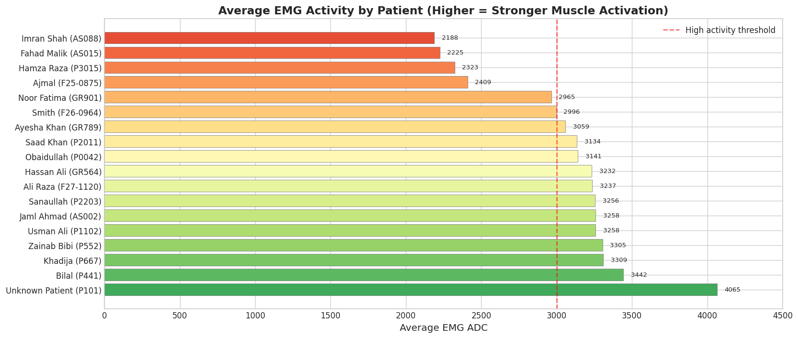
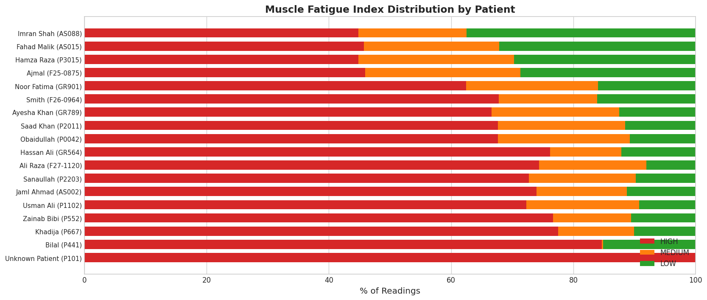
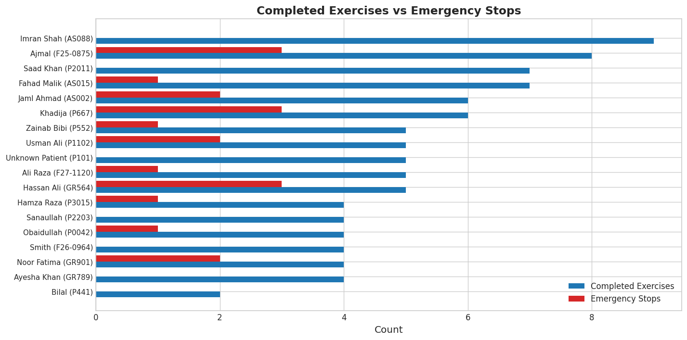
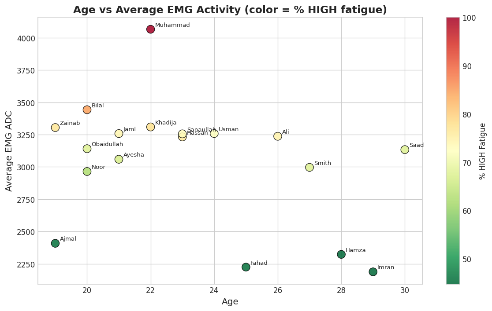
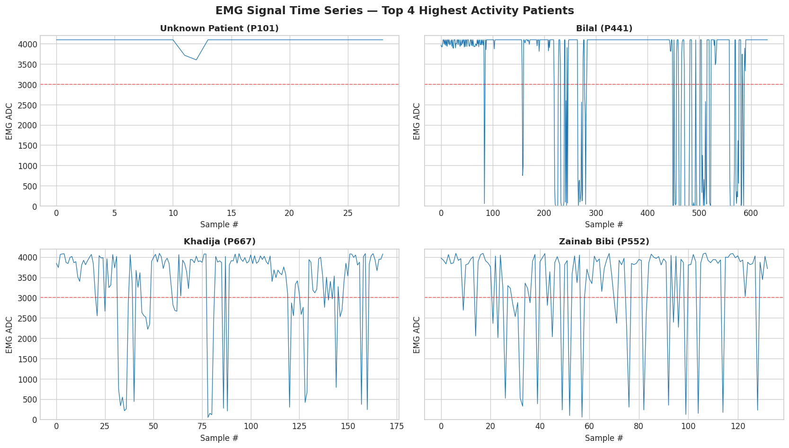
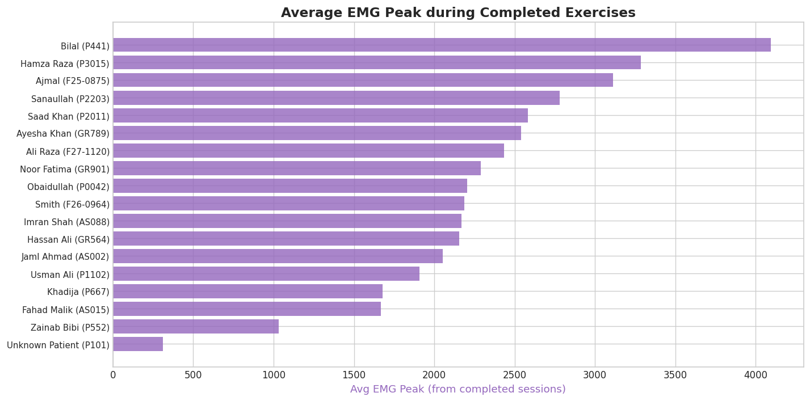
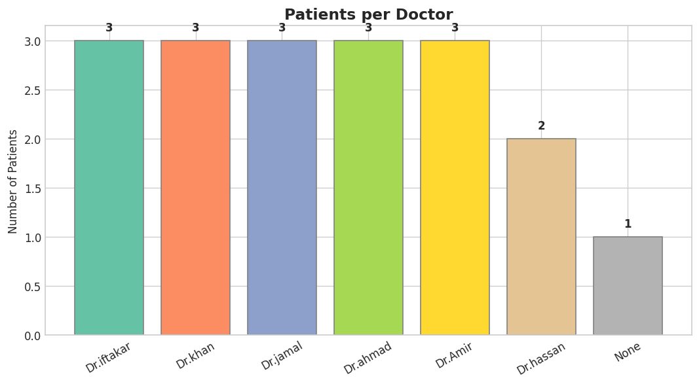
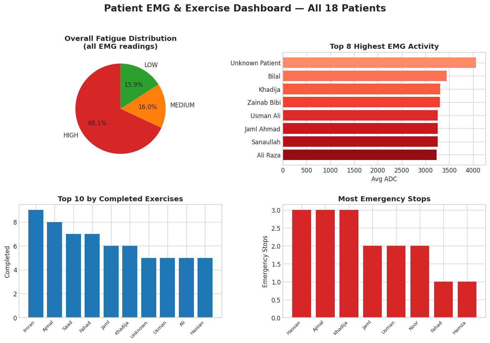

# ESP32 Smart Physiotherapy Glove

An **EMG-based hand rehabilitation prototype** designed to support hand exercise and muscle-activity monitoring using embedded systems and a web dashboard.

## Project Demo

**Main demonstration video**

[▶ Watch the Smart Physiotherapy Glove Demo](video/Muhammad_Ajmal_Soft_Robotic_Glove_Project%20(1).mp4)

## Key Features

- **EMG monitoring:** Reads muscle activity through an EMG sensor.
- **Pneumatic actuation:** Uses a pump and valves to assist hand movement.
- **Embedded control:** ESP32-based hardware integration.
- **User interface:** LCD and keypad for local interaction.
- **Web dashboard:** Flask-based backend for displaying and recording session data.
- **Data visualization:** Charts for exploring sample EMG and session results.

## Hardware and Software

| Component | Purpose |
|---|---|
| ESP32 | Embedded controller |
| EMG sensor | Muscle-activity measurement |
| Pump and pneumatic valves | Glove actuation |
| LCD and keypad | Local interface |
| Python and Flask | Backend and data handling |
| HTML, CSS and JavaScript | Web dashboard |

## Sample Results

The following charts illustrate analyses generated from the project's sample dataset.

### 1. Average EMG by Patient


### 2. Muscle Fatigue Distribution


### 3. Sessions and Emergency Events


### 4. Age vs. EMG


### 5. EMG Time Series


### 6. Average EMG Peak by Sessions


### 7. Patients per Doctor


### 8. Dashboard Overview


## Installation

Clone the repository:

```bash
git clone https://github.com/ajmal156/esp32-emg-smart-physiotherapy-glove.git
cd esp32-emg-smart-physiotherapy-glove
```

Install the Python dependencies:

```bash
pip install -r Requirement.txt
```

Run the backend using the project's configured entry point.

## Repository Structure

- `firmware/` — ESP32 firmware
- `hardware/` — Hardware documentation and diagrams
- `backend/` and `server/` — Backend code
- `webDashboard/` — Web interface
- `data/sample_logs/` — Sample data and result charts
- `docs/` — Project documentation
- `video/` and `media/` — Demonstration media

## Project Status

This is a prototype intended for development and testing. It is not a certified medical device and should not be used as a substitute for professional medical care.

## License

See [LICENSE](LICENSE) for licensing information.

## Citation

See [CITATION.md](CITATION.md) for citation details.

